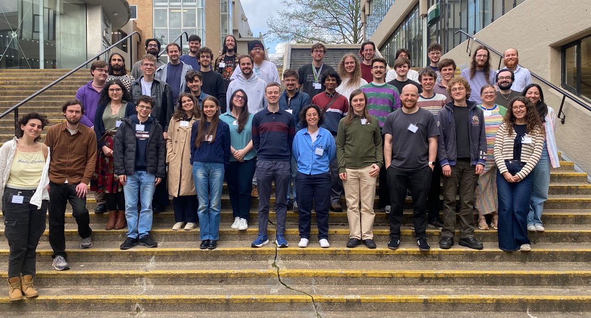

---
title: Skew braces, the YBE, and Dehornoy’s representation

event: Introduction to Modern Advances in Algebra
event_url: https://sites.google.com/view/itmaia2026

location: Leeds, UK

summary: ITMAIA

abstract: >-
This talk explores the interplay between algebraic structures known as skew braces and set-theoretic
solutions to the Yang–Baxter equation (YBE), a central object in mathematical physics and quantum group theory. Skew braces provide a powerful framework for constructing and analysing so-
lutions. We focus on the case of involutive solutions, examining their structure groups, associated
Coxeter-like groups, and permutation skew braces, which enable explicit computations and structural analysis. After reviewing the necessary background on skew braces and the YBE, we discuss
how the permutation skew brace captures essential symmetries of a solution and serves as an effective invariant. As an illustration, we briefly outline the classification of involutive solutions of size p^2,
where p is a prime (joint work with Carsten Dietzel and Senne Trappeniers). Finally, using the brace structure of the associated Coxeter-like groups, we show how Dehornoy’s monomial
representations reflect the indecomposability of the underlying solutions (joint work with Carsten
Dietzel and Edouard Feingesicht).

date: '2026-04-16'
all_day: true

authors:
  - admin

tags: []

featured: false

url_event: 'https://sites.google.com/view/itmaia2026'

slides: ""
---

